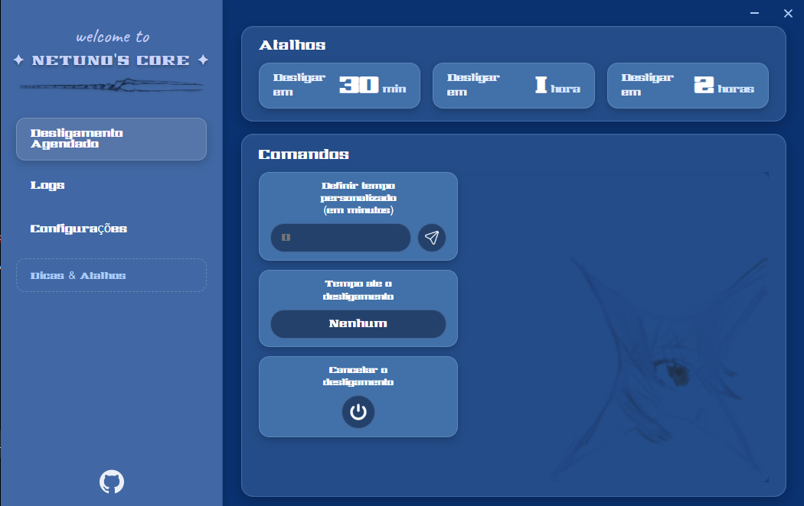
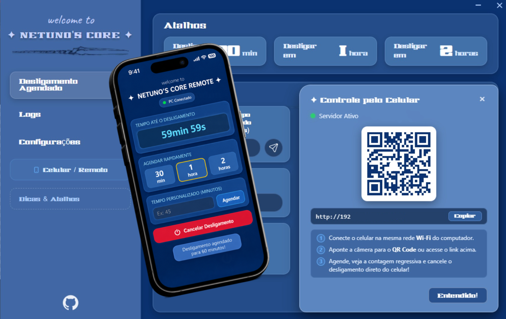
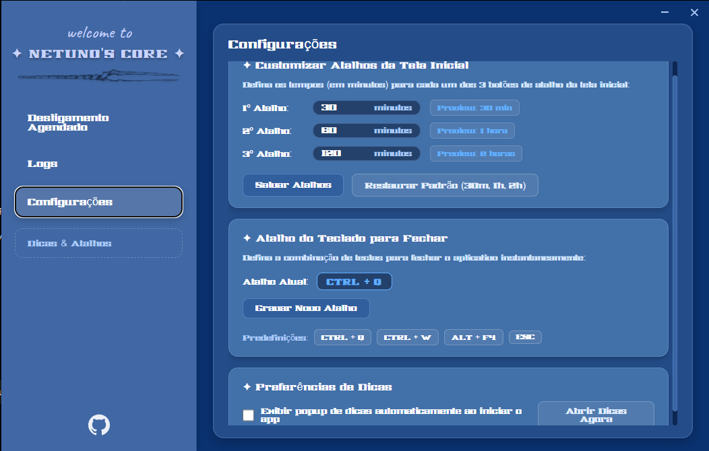
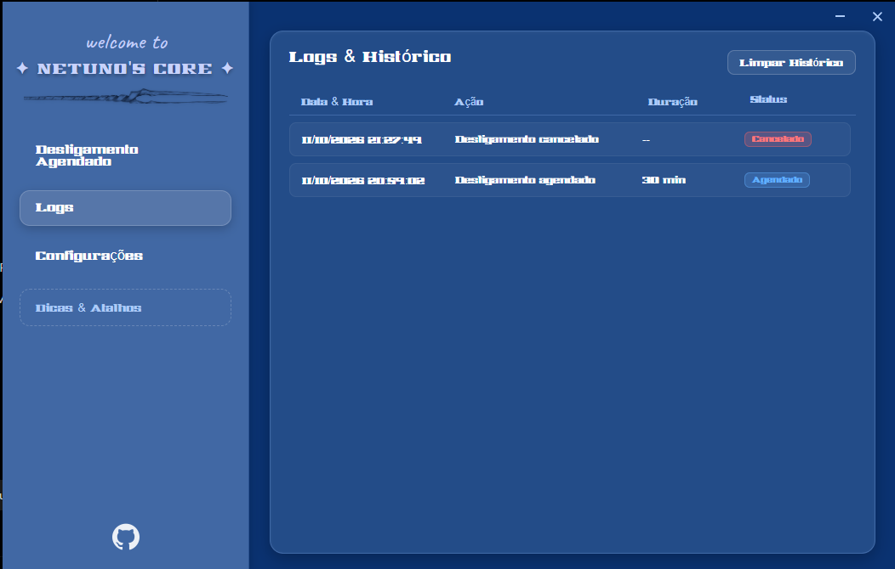

  

  <h1 align="center">✦ NETUNO'S CORE ✦</h1>

  
<strong>Agende o desligamento do seu computador sem precisar decorar comandos — agora com controle remoto pelo celular.</strong>

  
  
  

---

### Navegação

[Visão Geral](#visão-geral) · [Funcionalidades](#funcionalidades) · [Controle Remoto](#-controle-remoto-pelo-celular) · [Interface](#interface) · [Como Usar](#como-usar) · [Instalação](#instalação) · [Identidade Visual](#identidade-visual)

---

## Visão Geral

O **Netuno's Core** é um aplicativo nativo para **Windows** que simplifica e moderniza o agendamento de desligamentos do computador. Ele reúne em uma interface elegante e temática uma funcionalidade que normalmente exige comandos obscuros no prompt de comando (`shutdown -s -t ...`).

Com design inspirado na estética HUD e na personagem **Rei Ayanami** de *Neon Genesis Evangelion*, o app combina alto desempenho, baixo consumo de memória e total controle na ponta dos seus dedos — seja pelo PC ou pelo seu smartphone na mesma rede Wi-Fi.

---

## Funcionalidades

| Recurso | Descrição |
| :--- | :--- |
| **Atalhos Rápidos** | Agende o desligamento com um único clique em botões personalizáveis (padrão: 30 min, 1 hora, 2 horas). |
| **Tempo Personalizado** | Defina qualquer valor em minutos (de 1 minuto até vários dias) de forma direta e descomplicada. |
| **Controle Remoto (Wi-Fi)** | Controle o desligamento do PC a partir de qualquer celular ou tablet conectado na mesma rede local. |
| **Monitoramento em Tempo Real** | Display dinâmico exibindo a contagem regressiva precisa até o desligamento. |
| **Cancelamento Imediato** | Interrompa o desligamento a qualquer momento com o botão de cancelamento ou via celular. |
| **Bandeja do Sistema (Tray)** | Mantenha o app em segundo plano e use o menu de contexto da bandeja com atalhos dinâmicos. |
| **Configuração de Fechamento** | Escolha entre perguntar sempre, minimizar para a bandeja ou fechar o app diretamente. |
| **Logs & Histórico** | Registro detalhado de data, hora, ação e duração de cada agendamento/cancelamento, com opção de limpeza. |
| **Atalho de Teclado** | Feche o aplicativo instantaneamente com a tecla de atalho configurável (padrão: `Ctrl + Q`). |
| **Verificador de Atualizações** | Notificação automática e manual de novas versões disponibilizadas no repositório oficial. |

---

## ✦ Controle Remoto pelo Celular

Não precisa se levantar da cama para desligar o computador:

1. Clique no botão **Celular / Remoto** na barra lateral do Netuno's Core.
2. Certifique-se de que o seu celular está conectado à mesma rede **Wi-Fi** do computador.
3. Aponte a câmera do celular para o **QR Code** exibido (ou digite o endereço IP local mostrado).
4. Uma página web rápida, responsiva e segura será aberta no navegador do seu smartphone.
5. Você poderá acompanhar a contagem regressiva, agendar rapidamente, definir minutos personalizados ou cancelar o desligamento.

---

## Interface

| Desligamento Agendado | Controle Remoto (Celular) |
| :---: | :---: |
|  |  |
| **Configurações & Atalhos** | **Logs & Histórico** |
|  |  |

---

## Como Usar

1. Inicie o **Netuno's Core**.
2. Clique em um dos atalhos de tempo ou digite os minutos no campo de tempo personalizado.
3. Acompanhe a contagem regressiva na tela inicial ou pelo celular escaneando o QR Code.
4. Se precisar cancelar, clique no botão de energia (**Cancelar o desligamento**) no app, na bandeja ou no celular.
5. Para ajustar seus próprios tempos ou modificar o atalho do teclado, acesse a aba **Configurações**.

> [!IMPORTANT]
> Salve todos os seus trabalhos e arquivos abertos antes do horário programado. Fechar a janela principal não cancela um desligamento agendado ativo no sistema operacional. Para interromper, utilize sempre o comando de **Cancelar o desligamento**.

---

## Instalação

Escolha a opção que melhor se adapta ao seu estilo na página de [Releases](https://github.com/7rafas/Netunos-Core/releases/latest):

| Distribuição | Arquivo | Descrição |
| :--- | :--- | :--- |
| **Instalador Autônomo** | `Netunos-Core-Setup.exe` | Assistente completo com atalhos na Área de Trabalho/Menu Iniciar e desinstalador registrado no Windows. |
| **Portátil (Portable)** | `Netunos-Core-Portable.zip` | Não requer instalação. Basta descompactar em qualquer pasta ou pendrive e executar. |

- **Sistema Operacional:** Windows 10 / Windows 11 (64-bit)  
- **Idioma da Interface:** Português (Brasil)  
- **Dependências:** WebView2 Runtime (já nativo no Windows 10/11 atualizados)

---

## Identidade Visual

A estética tecnológica em tons azuis (`#0A3271`, `#4168A4`, `#62B0FF`) do Netuno's Core é uma homenagem visual inspirada na personagem **Rei Ayanami** e na icônica Lança de Longinus de *Neon Genesis Evangelion*.

> *Projeto independente de código aberto desenvolvido por paixão e utilidade prática, sem vínculo comercial com Neon Genesis Evangelion ou com seus respectivos detentores de direitos.*

---

  Netuno's Core v1.1.0 — Desenvolvido por <a href="https://github.com/7rafas">Rafael F. (@7rafas)</a>

