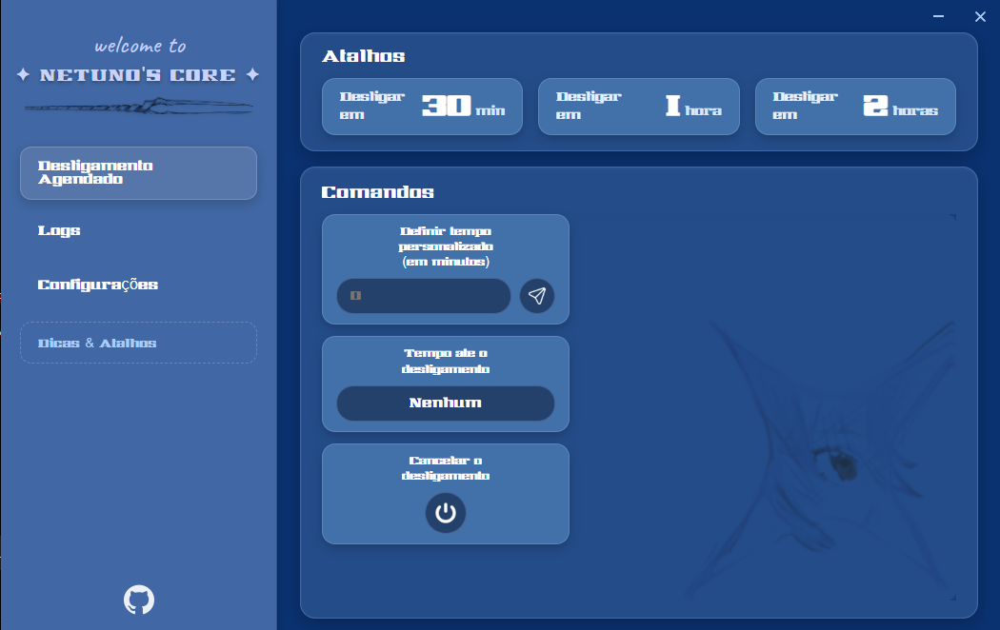
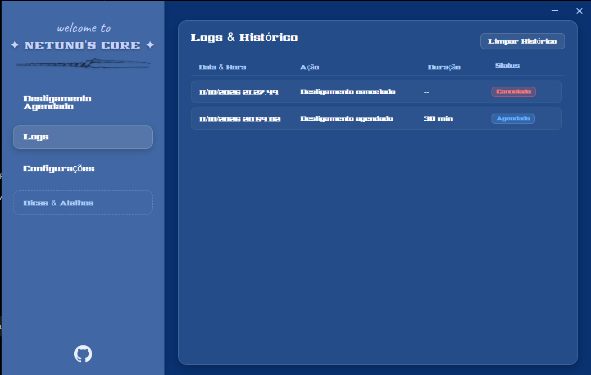
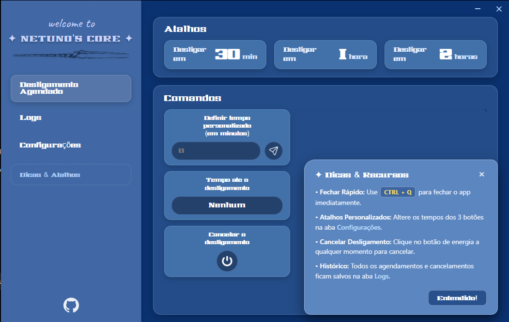
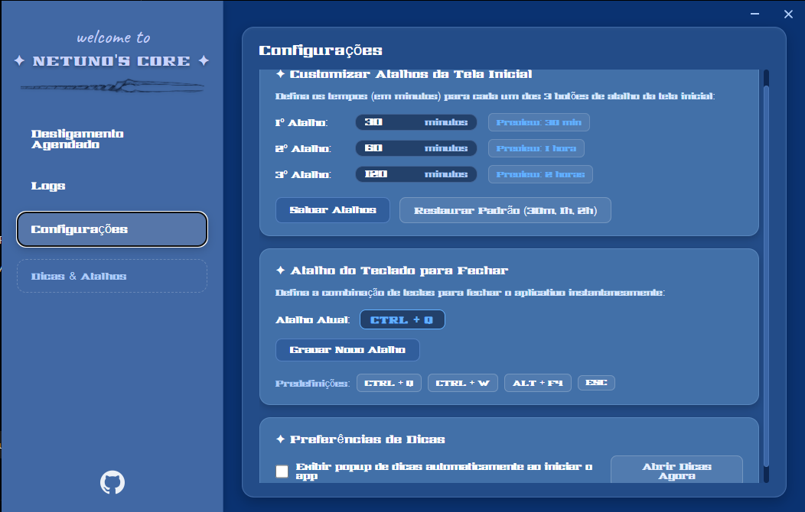

  

  <h1 align="center">Netuno's Core</h1>

  
<strong>Agende o desligamento do seu computador sem precisar decorar comandos.</strong>

  
  
  

  
<a href="https://github.com/SEU_USUARIO/Netunos-Core/releases/latest"><strong>⬇️ Baixar a versão mais recente</strong></a>

---

## Navegação

[Visão geral](#visão-geral) · [Funcionalidades](#funcionalidades) · [Interface](#interface) · [Como usar](#como-usar) · [Instalação](#instalação) · [Identidade visual](#identidade-visual)

---

## Visão geral

O **Netuno's Core** é um aplicativo para **Windows** que simplifica o agendamento de desligamentos do computador. Ele reúne em uma interface intuitiva uma funcionalidade que normalmente exige o uso de comandos no terminal.

A proposta é tornar o **desligamento agendado mais acessível e conhecido**: você determina em quanto tempo deseja desligar o PC, acompanha o agendamento e pode cancelá-lo sem precisar digitar comandos.

## Funcionalidades

| Recurso | O que faz |
| :--- | :--- |
| **Atalhos de desligamento** | Agende em **30 minutos**, **1 hora** ou **2 horas** com um clique. |
| **Tempo personalizado** | Informe um período em minutos para agendar o desligamento. |
| **Tempo restante** | Veja na tela inicial quanto falta para o desligamento programado. |
| **Cancelamento** | Cancele um agendamento usando o botão dedicado. |
| **Logs e histórico** | Consulte data, horário, duração, ação e status dos agendamentos; limpe o histórico quando desejar. |
| **Atalhos configuráveis** | Altere os tempos dos três botões rápidos nas configurações. |
| **Atalho de teclado** | Personalize a combinação para fechar o aplicativo (padrão: `Ctrl + Q`). |
| **Dicas integradas** | Consulte orientações de uso e escolha se elas devem aparecer automaticamente ao iniciar. |

## Interface

| Desligamento agendado | Logs e histórico |
| :---: | :---: |
|  |  |
| **Dicas e recursos** | **Configurações** |
|  |  |

## Como usar

1. Abra o **Netuno's Core**.
2. Selecione um dos três atalhos de desligamento ou digite um tempo personalizado em minutos.
3. Acompanhe o tempo restante na tela inicial.
4. Caso não queira mais desligar o computador, clique em **Cancelar o desligamento**.
5. Para modificar atalhos e preferências, acesse **Configurações**; para consultar os registros, abra **Logs**.

> [!IMPORTANT]
> **Salve seus arquivos antes do horário programado.** Fechar a janela do aplicativo não deve ser usado como forma de cancelar o desligamento. Utilize o comando **Cancelar o desligamento** para isso.

## Instalação

Encontre as duas opções na página de [Releases](https://github.com/SEU_USUARIO/Netunos-Core/releases/latest):

| Distribuição | Arquivo | Como utilizar |
| :--- | :--- | :--- |
| **Instalável** | `Netunos-Core-Setup.exe` | Baixe e execute o instalador. |
| **Portátil** | `Netunos-Core-Portable.zip` | Extraia o ZIP e execute o aplicativo na pasta extraída. |

**Sistema operacional:** Windows.  
**Idioma da interface:** Português (Brasil).

## Identidade visual

A estética azul do Netuno's Core tem como inspiração visual **Rei Ayanami**, de *Neon Genesis Evangelion*. A referência foi uma escolha pessoal para dar identidade ao aplicativo.

> Projeto independente, sem vínculo oficial com *Neon Genesis Evangelion* ou seus detentores de direitos.

---

  Netuno's Core — desligamento agendado de forma simples.

